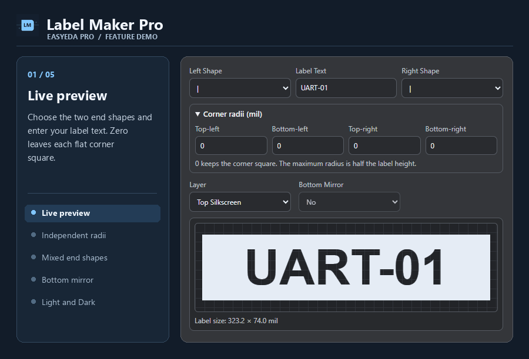
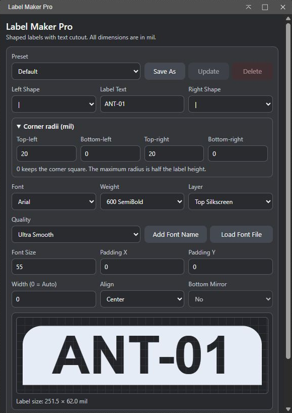

# Label Maker Pro for EasyEDA Pro

Create PCB silkscreen labels with cutout text for connectors, test points, and board markings. Shape each end, fine-tune the corners, and see the result before placing it on the board.

[Download v1.1.0 (.eext)](https://github.com/grzegorzwozny/easyeda-pro-labelmaker-pro/releases/download/v1.1.0/eext-labelmaker-pro_v1.1.0.eext) · [Changelog](CHANGELOG.md)

## See it in action



The demo uses the extension’s preview with a sample label. It shows how to round two corners independently, combine flat and curved ends, and mirror a bottom silkscreen label.

## Features

- **Independent corner radii** for the top-left, top-right, bottom-left, and bottom-right corners of flat ends.
- **Live preview** for end shapes, text cutouts, dimensions in mil, and bottom silkscreen mirroring.
- **Typography and sizing** with font weight, local font files, padding, alignment, and three quality profiles.
- **Reusable presets** for consistent labels across a PCB, plus Light and Dark styling that follows EasyEDA Pro.

## Install or update in EasyEDA Pro 3.x

1. Download the `.eext` file from [GitHub Releases](https://github.com/grzegorzwozny/easyeda-pro-labelmaker-pro/releases) or build it locally.
2. In EasyEDA Pro, open **Advanced → Extension Manager → Import** and select the `.eext` file.
3. For an update from v1.0.0, import the new file over the existing installation. Check the active version and enable **Label Maker Pro** under **Installed**.
4. Open a PCB and choose **Label Maker → Open Label Maker…**. If **Show in top menu** is off, look under **Advanced**.

The update uses the same extension UUID and preset storage keys. Existing settings and presets load with zero radii.

## Create a label

1. Set the text, font, weight, padding, and left and right end shapes. Dimensions use mil. **Width** sets a minimum width for the straight central section. Set it to **0** for automatic sizing.
2. Choose a flat end (`|`, `[`, or `]`) and expand **Corner radii (mil)**. Set each available corner independently. Zero leaves it square. Radii above half the label height are limited automatically and the preview shows the result.
3. Choose a silkscreen layer and a quality profile. **Bottom Mirror** horizontally flips the whole label on the bottom layer, including its corners. The live preview shows that orientation as viewed from the top of the PCB.
4. Click **Place Label**, move the label to the desired point on the PCB, and click to place it. Press **Esc** to cancel and return to the settings.

Use **Save As**, **Update**, and **Delete** to manage custom presets. **Load Font File** loads a local font for the current window session.

## Native Dark theme



The screenshot shows the extension running in EasyEDA Pro 3.2.209, with 20 mil radii on both top corners and square bottom corners.

## Build from source

With Node.js 20.17 or later:

```sh
npm ci
npm run build
```

The build creates `build/dist/eext-labelmaker-pro_v1.1.0.eext`.

## Extension Marketplace

Maintainers can submit the `.eext` package through [Extension Management](https://jlcext.com/) for review. For a first listing, confirm the publishing UUID with the Marketplace before changing the existing extension identity. See the [official publishing guide](https://prodocs.easyeda.com/en/api/guide/extensions-marketplace.html).
