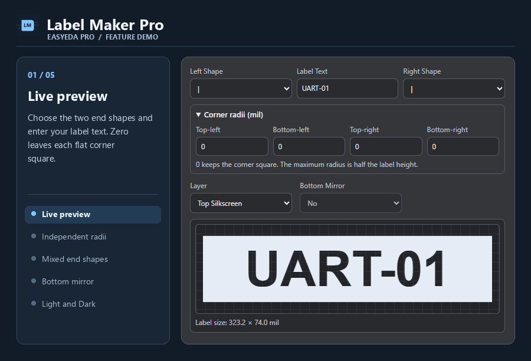
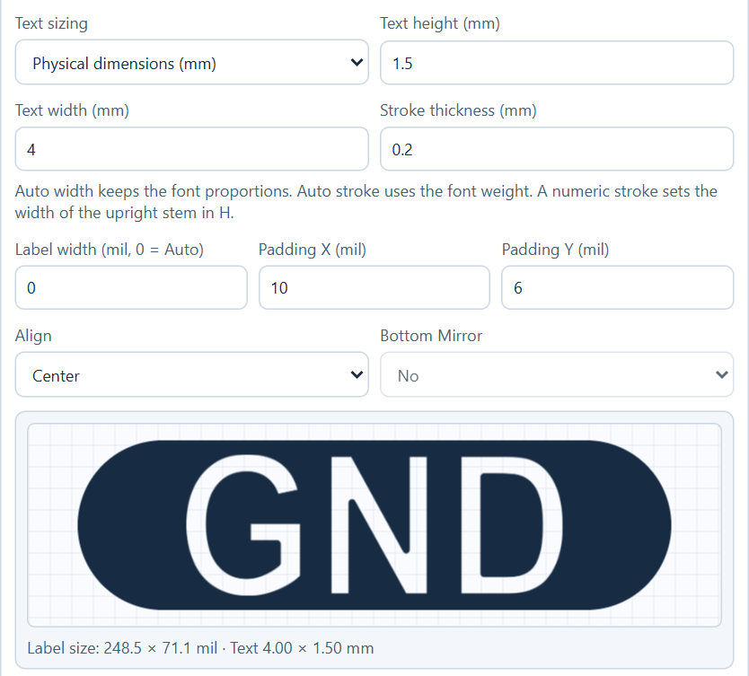

# Label Maker Pro for EasyEDA Pro

By **Moisen**.

Create PCB silkscreen labels with cutout text for connectors, test points, and board markings. Shape each end, fine-tune the corners, and see the result before placing it on the board.

[Download v1.2.0 (.eext)](https://raw.githubusercontent.com/grzegorzwozny/easyeda-pro-labelmaker-pro/v1.2.0/build/dist/eext-labelmaker-pro_v1.2.0.eext) · [Changelog](CHANGELOG.md)

## See it in action



Watch the label change as you round individual corners, combine flat and curved ends, and switch on bottom silkscreen mirroring. [View the animation on GitHub](https://github.com/grzegorzwozny/easyeda-pro-labelmaker-pro/blob/v1.2.0/docs/label-maker-pro-demo.gif)

## Features

- **Independent corner radii** for the top-left, top-right, bottom-left, and bottom-right corners of flat ends.
- **Live preview** for end shapes, text cutouts, dimensions in mil, and bottom silkscreen mirroring.
- **Typography and sizing** with the usual font size or a measured text height, total text width, and stroke thickness in millimetres. Both modes support font selection, alignment, and presets.
- **Reusable presets** for consistent labels across a PCB, plus Light and Dark styling that follows EasyEDA Pro.

## Install or update in EasyEDA Pro 3.x

1. Download the `.eext` file at the top of this page or build it locally.
2. In EasyEDA Pro, open **Advanced → Extension Manager → Import** and select the `.eext` file.
3. To update an installed copy, import the new file over it. Under **Installed**, check that **Label Maker Pro 1.2.0** is enabled.
4. Open a PCB and choose **Label Maker → Open Label Maker…**. If **Show in top menu** is off, look under **Advanced**.

The update keeps your settings and presets. Presets from v1.0.0 start with square corners.

## Create a label

1. Set the text, font, weight, padding, and left and right end shapes. **Label width (mil)** sets a minimum width for the straight central section. Set it to **0** for automatic sizing.
2. Choose a flat end (`|`, `[`, or `]`) and expand **Corner radii (mil)**. Set each available corner independently. Zero leaves it square. Radii above half the label height are limited automatically and the preview shows the result.
3. Choose a silkscreen layer and a quality profile. **Bottom Mirror** horizontally flips the whole label on the bottom layer, including its corners. The live preview shows that orientation as viewed from the top of the PCB.
4. Click **Place Label**, move the label to the desired point on the PCB, and click to place it. Press **Esc** to cancel and return to the settings.

Use **Save As**, **Update**, and **Delete** to manage custom presets. **Load Font File** loads a local font for the current window session.

### Set the text dimensions in millimetres

Choose **Text sizing → Physical dimensions (mm)**. **Text height** measures the visible letters, including any accents and descenders. Enter **1.5** for lettering 1.5 mm tall. Padding, end shapes and the label background are sized separately.

- **Text width** sets the width of the whole inscription. For example, enter **4** to fit `GND` in 4 mm. Leave the field empty or enter **0** to preserve the font proportions.
- **Stroke thickness** sets the width of the selected font’s upright stem in a reference capital H. Enter **0.20** for a 0.20 mm stem. Curves, serifs and horizontal strokes follow the typeface and any horizontal stretch. An empty field or **0** uses the selected font weight.

The preview shows the resulting text width and height in mm alongside the label size in mil. Negative padding can clip the cutout. **Font size** is the default for new installations and presets saved in earlier versions.



## Native Dark theme


The screenshot shows the extension running in EasyEDA Pro 3.2.209, with 20 mil radii on both top corners and square bottom corners. [View the full-size screenshot on GitHub](https://github.com/grzegorzwozny/easyeda-pro-labelmaker-pro/blob/v1.2.0/docs/label-maker-pro-dark.png)

## Build from source

With Node.js 20.17 or later:

```sh
npm ci
npm run build
```

The build creates `build/dist/eext-labelmaker-pro_v1.2.0.eext`.

## Extension Marketplace

To submit a new version, open **Extension Management → Upload Extension** on JLCEXT and select the `.eext` file. The marketplace uses the extension UUID to group versions under the same listing. [Official publishing guide](https://prodocs.easyeda.com/en/api/guide/extensions-marketplace.html)
